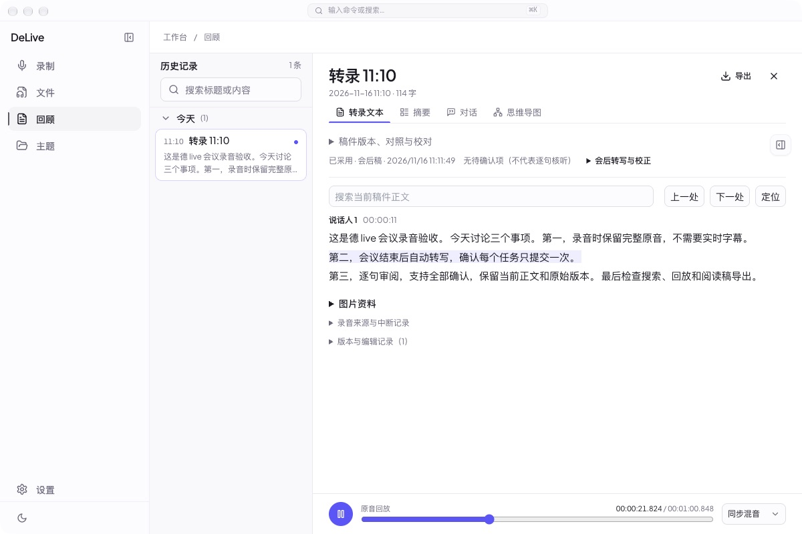
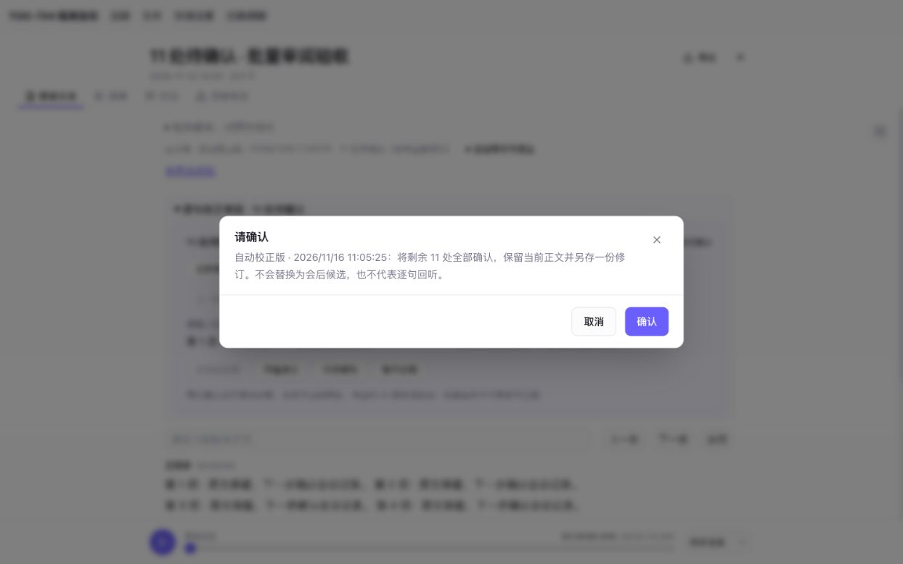
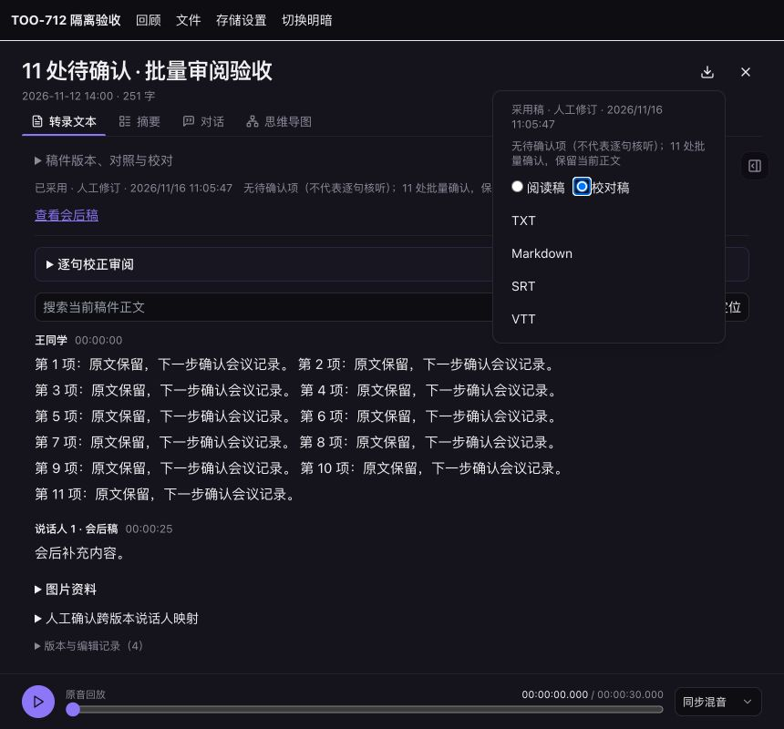
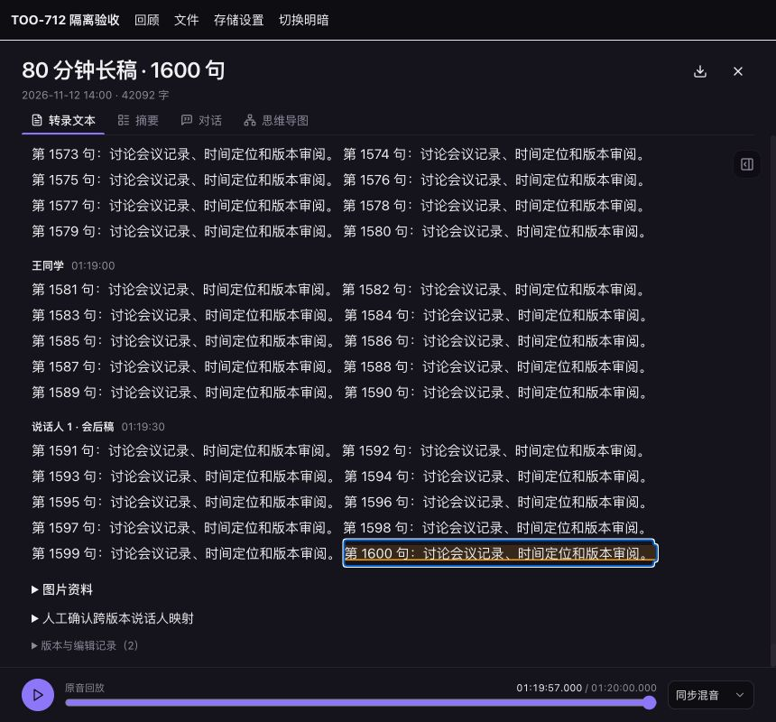

# TOO-712 录音与稿件审阅验收

2026-11-16，sqmc03。本地分支 `suqing/too-712-recording-review`，基线 `ca9d6a9`。需求：[TOO-712](https://linear.app/sisyphus-sq/issue/TOO-712)。已实现并完成下述开发验证，交付人工 Review；随后按用户指示完成 `2.3.0-sq.3` 本机安装，详见文末。代码未提交、推送或合并，未公开发布。

## 实现范围

- 录制入口选择只录音/实时转录并持久保存；独立的结束后自动转写开关，首次启用说明上传与计费。自动任务等待原音和索引落盘，按录制开始时选择执行一次；异常结束和保存失败不自动上传。
- 会后稿独立保存、显式生成校正版。查看、保存修订和采用保持独立；旧稿、人工稿及草稿继续保护。
- 全部确认仅把当前版本剩余待确认项标记为 `keep-current`，一次保存一份修订，不改正文、时间、身份或已有决定。重启/正规化保留批量记录，不宣称逐句核听。
- 状态区分原音/会后任务/稿件；历史识别异常收进详情，当前临时文字和音频中断仍提示。正文按连续身份合段，支持当前稿搜索与原音定位。
- 阅读稿与校对稿导出；字幕继续保持逐句时间。审阅可暂不处理、播放区段前后文。

## 开发检查

- 全量前端：64 个文件、495 项测试通过（`tests.log`）。随后补齐设备异常结束/重采集失败禁用自动上传，相关 hook 与回放共 14 项复测通过（`tests-final-fix.log`），未把两轮重复测试相加。
- 最终前端 TypeScript 与 Vite 构建通过；Electron 构建通过。ESLint 0 错误、10 个现有 hooks/热更新警告。构建保留既有大 chunk 提示。
- 自审修正：异常设备结束和重采集失败不能自动上传；正在查看的未采用版本在折叠工具栏后仍显示名称；停止阶段准确显示完成原音保存。
- 无新依赖、任务调度器或审阅存储。沿用现有串行持久化、任务状态、清理、采用和版本恢复路径。

日志、测试 profile、两段实际原音及下载文件位于本机 `/Users/suqing/Coding/app/DeLive/tmp/evidence/too-712/`（忽略目录，不提交）。只有去敏截图和统计复制到本文的 evidence 目录。没有复制历史会议到验收 profile，也没有上传历史会议音频。

## 真实录音与服务

使用独立 Electron profile、实际系统音和内置麦克风、通用中文验收播报，调用已配置的火山服务。

1. **只录音 → 自动会后转写**：60.848 秒、61 个连续分片，三轨都有非零采样。停止后只调用一次 `file-tasks:start`，`reconcile=false`；任务完成且 `cleanup=done`。会后稿包含六个分句，首份会后稿成为采用稿，无自动混合校正版。UI 定位 21.280 秒并开始原音回放。
2. **实时识别断连与恢复**：69.936 秒、70 个连续分片。约 11 秒时只断开验收进程的一条识别 WebSocket；界面明确显示“转写失败；本地原音继续保存”，手动重连成功。故障前 5–10 秒与故障后 15–20 秒系统音 RMS 分别 4182.05 / 3883.59，混音 2091.08 / 1941.76；全段分片间隙为 0。关闭自动开关后没有增加文件任务。
3. **重启**：重启隔离客户端，模式及自动开关保留，首个已完成任务仍仅一个；两条会议与原音重开可用。交付时隔离客户端为只录音、自动转写关闭，当前展示真实会后稿。

[去敏统计](./evidence/too-712/live-results.json)记录实际时长、三轨采样、故障连接及唯一文件任务。非零麦克风仅证明有采样，不等于多人会议收音质量验收。

## 实际渲染与交互

通过 CUA 操作正式组件，先整页后局部查看，检查白色宽窗和深色 860×800 窄窗；没有发现明显遮挡或正文丢失。基础键盘操作已检查，未进行完整可访问性认证。

1. **批量审阅**：11 个 pending，一次对话框确认后新增一份修订，版本 3→4，pending 11→0；原采用稿保持，明确采用后重开仍保留 11 处批量记录。切回旧版仍为 11 pending，采用稿保持新修订。
2. **草稿/跳过**：暂不处理跳到第二项而计数仍为 11；手改草稿存在时“全部确认”和采用均禁用。放弃草稿需要一次确认。
3. **搜索与导出**：搜索第 3 项定位到 4 秒；实际下载阅读 Markdown 与校对 TXT，逐项检查 11 段正文和批量记录均存在。方向键可切换用途；当前稿件菜单可用方向键和 Enter 切版。播放区段截止时间由回放单元测试验证，UI 已验证能启动该区段回放。
4. **长稿**：80 分钟、1600 句合成样本，深色窄窗可阅读，搜索最后一句后滚动到该句，原音游标为 01:19:57。此项是长稿界面验证，不是重新录制 80 分钟的硬件验收。

## 验收覆盖与边界

| 场景 | 本轮证据 |
| --- | --- |
| A01–A04 模式、停止顺序、唯一任务、重启 | 实际短录音/服务/重启；无实时密钥的只录音和重复停止由 hook 测试覆盖。快捷键沿用同一个启动函数，未重复实按全局快捷键。 |
| A05 异常与保存失败 | hook 测试覆盖原音/索引/服务失败、设备结束与重采集失败；既有任务测试覆盖落库、清理、重试。未制造真实磁盘写满或云端清理故障。 |
| A06–A07 版本与身份 | 真实无实时稿直接采用；既有与新增合并/结果补入测试覆盖独立保存、草稿、身份与删除；本轮未增加跨版本身份推断。 |
| A08–A10 批量确认与恢复 | 11 项 UI、正文/分句/身份不变单测、普通与历史恢复结构正规化测试；UI 验证重开和草稿保护。备份复用同一正规化，未额外跑完整云备份往返。 |
| A11 单项审阅与状态 | 暂不处理、草稿、区段回放 UI；片段精确停止单测；任务完成后无残留已提交提示。 |
| A12–A13 阅读、搜索和导出 | 1600 句 UI、实际两种文字下载及导出单测；SRT/VTT 既有测试通过。 |
| A14 真实环境与视觉 | 两段真实双来源短录音、识别断连/重连、宽窄窗明暗均已检查；本轮未做新的 80 分钟连续硬件录音、蓝牙和多人收音矩阵。 |

## 人工验证入口

- 独立桌面验收窗口已在本机安装前关闭，验收数据保留。回顾列表的“转录 11:10”为完整会后稿，“转录 11:14”为断连/重连后的实时稿。按下述命令重开后可搜索、点击文字回放、查看任务及导出。
- [批量确认验收页](http://127.0.0.1:5173/acceptance/too704/index.html?scenario=batch)保留已确认修订；展开稿件版本选择“自动校正版”，再展开逐句审阅，即可再次体验 11 项全部确认。全部确认只保留当前正文，采用需单独点击。
- [80 分钟长稿](http://127.0.0.1:5173/acceptance/too704/index.html?scenario=long)使用合成静音原音，不调用云端。
- 服务关闭后，在仓库启动 `npm run dev:client` 可打开以上验收页；桌面验收命令为 `NODE_ENV=production node_modules/.bin/electron tmp/evidence/too-712/live.cjs`。该脚本和私有测试 profile 仅在本机保留。

剩余人工重点：实际会议的长时采集、收音质量，以及“一键全部确认保留正文”的交互是否符合使用习惯。本轮没有把模型转写正确率或批量确认当作逐句核听证明。

## 2.3.0-sq.3 本机安装与清理

- 用户授权自动递增版本、完成本机上线后删除 Agent 留下的备份。`package.json` 与 lockfile 同步为 `2.3.0-sq.3`；构建、Developer ID 签名、DMG/ZIP 打包完成。
- 初次 OCSP 在线校验因撤销服务检查失败而停止；使用同一证书和相同严格策略重试成功，再归档已签名应用，未绕过安全检查。团队 `9FZ62TNHWJ` 与 appId 保持不变；未进行 Apple 公证。
- `/Applications/DeLive SQ.app` 已替换并启动，实际“关于”显示 `2.3.0-sq.3`，回顾列表保留 18 条。安装包与已安装 `app.asar` SHA-256 一致。
- 安装前后 18 份录音索引摘要、45,902 个 WAV 的数量及总大小（4,405,244,776 字节）和 5 份加密配置/安全存储摘要一致。没有对全部音频内容重新计算摘要。
- 新版启动后删除本次及既往安装流程留下的 22 处应用/安装数据备份，逐项回读均不存在。保留正式安装包、活动用户数据、会议原音、用户管理的备份与验收证据。
- 产物位于 `release/2.3.0-sq.3/`；安装、数据比对及清理回执位于 `tmp/evidence/too-712/install-receipt.json`、`install-before.json`、`install-after.json` 和 `backup-cleanup-receipt.json`。关于页截图为同目录 `installed-sq3.png`。
- 本次按约定未重复执行测试；上述开发证据继续有效，但不扩展其场景范围。未提交、推送、打标签或创建 GitHub Release；Linear 保持 Human Review，等待人工验收。
