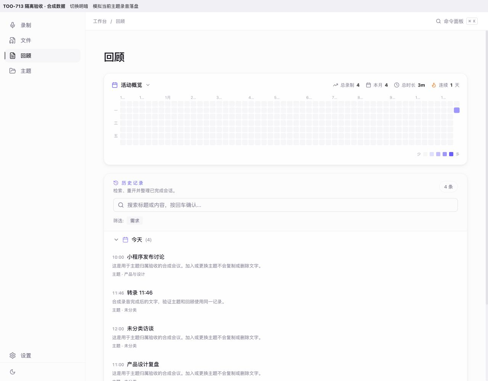
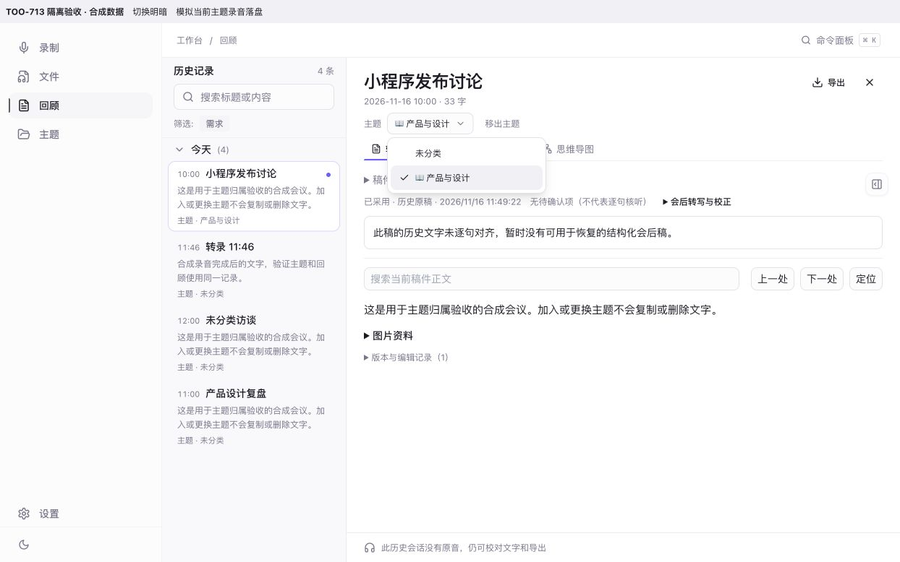
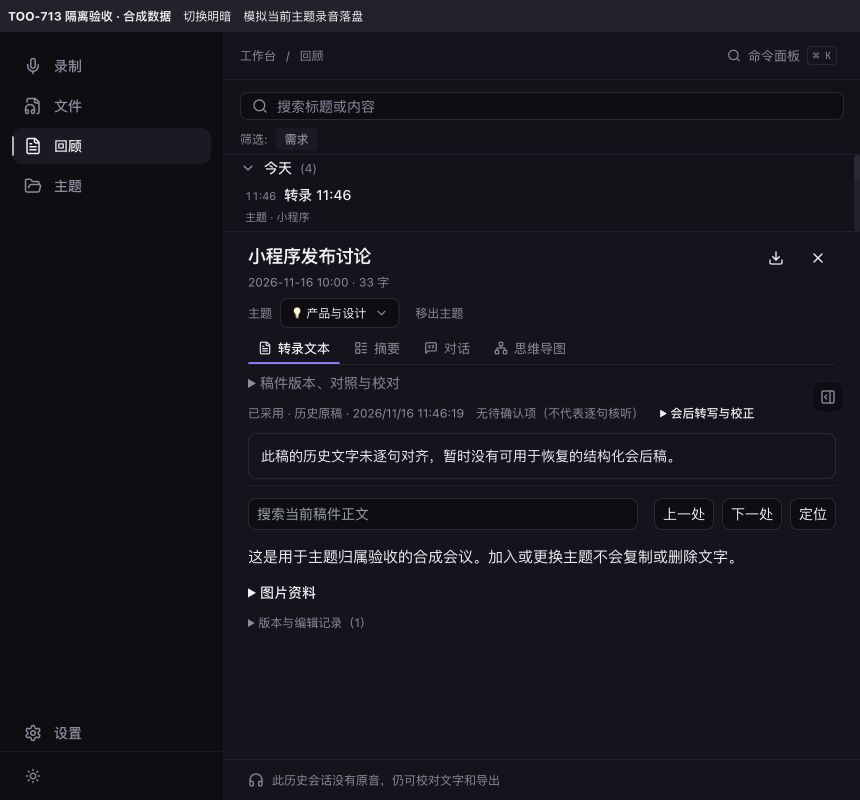
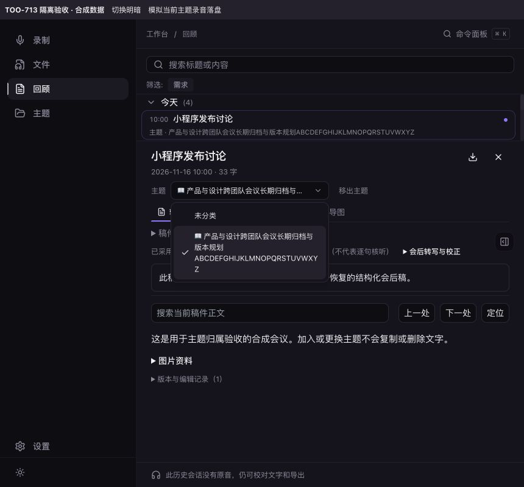
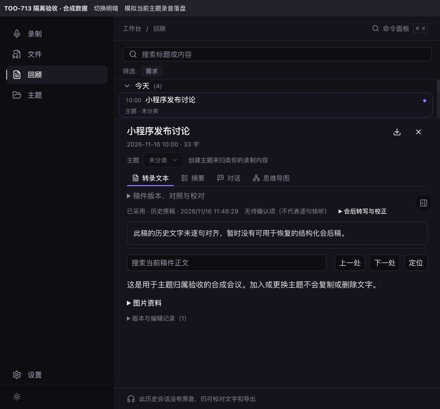

# TOO-713 回顾与主题联动验收

日期：2026-11-16。分支 `suqing/too-713-review-topics`；基线 `main / f35ff31`（TOO-712 合并后，2.3.0-sq.3）。本轮为本地开发和验证，未提交、推送、安装或发布。

## 实现与范围

- 回顾首页、详情侧栏均使用全部会话，再按现有搜索／标签条件筛选；主题页继续使用同一 store 按 `topicId` 过滤。
- 列表显示所属主题或未分类；详情标题下复用应用内 Select，可加入、直接更换、选择未分类或显式移出。删除原来摘要折叠区内的主题菜单，无说话人时不保留空概览折叠栏。
- 主题变更复用仓库串行持久化方法，成功后才发布到 store；失败提示且保留原归属。录音启动的调用方等待归属保存，失败沿用停止与禁止自动上传路径。
- 保留 ID、文字、原音引用和稿件版本，不引入迁移、依赖或同步机制。中英文使用说明、Unreleased 更新日志已同步。

## 自动化证据

针对性测试共 **5 个文件、28 项通过**（去重计数）：

- `tests.log`／`tests-final.log`：sessionTopic、topicStore、useASR.recording、sessionRepository 四文件 23 项通过。
- `history-tests.log`：HistoryPanel 五项通过，覆盖首页／侧栏全部主题录音、归属文案、搜索和标签筛选命中数，以及摘要概览只在有说话人时出现。初次静态渲染测试读取 Zustand 默认快照而不是设定 fixture，调整为明确的 SSR 快照后通过；不是生产逻辑回归。
- sessionTopic 验证加入、更换、移出后重载，正文／音频引用／版本不变；保存失败后内存与落盘仍保留原归属，下一次可重试；删除主题后录音仍保留。
- useASR.recording 使用采集替身验证主题保存失败能停止并禁止自动上传，以及成功路径进入录制。不是硬件录音证据。
- 前端 TypeScript + Vite 构建通过；ESLint 0 错误、10 个既有警告；构建保留既有大 chunk 提示。日志 `build-final.log`、`lint-final.log`。
- 删除一个只断言本地常量、还声称概览负责主题的旧测试；未为此次变更增加依赖或锁死无关字段。

日志位于本机 `/Users/suqing/Coding/app/DeLive/tmp/evidence/too-713/`，不提交日志。测试中的磁盘错误为注入失败，未制造真实磁盘满。

## 实际渲染与交互自审

入口：`http://127.0.0.1:5176/acceptance/too713/index.html`。通过 CUA 操作正式 App 组件，在独立浏览器 origin 中使用合成数据与 IndexedDB，未读取或修改桌面历史会议。首次打开初始化三条会议，刷新不重置；测试中新增一条合成落盘会话。

| 步骤 | 操作与观察 | 状态 |
| --- | --- | --- |
| 1 | 首页和详情侧栏均显示不同主题与未分类的三条录音；总数、日期分组一致 | 通过 |
| 2 | 详情标题下用键盘方向键／Enter 直接更换主题，再选择未分类并重新加入；标题与侧栏归属同时更新 | 通过 |
| 3 | 从主题进入同一会议，变更后返回原主题已不含该记录；主题页统计同步 | 通过 |
| 4 | 从主题“录制新内容”进入，预选归属正确；验收按钮调用真实会话创建、归属、结束持久化流程，合成第四条同时出现在回顾与归属状态中 | 通过，模拟落盘 |
| 5 | 搜索与标签筛选显示 1/4；热力图保持总数 4，点击当天日期显示 4/4；清除后恢复全部 | 通过 |
| 6 | 页面完整重载后归属保留；删除两个合成主题后再重载，四条录音仍可打开，空主题选择器显示未分类及创建提示 | 通过 |
| 7 | 摘要页无说话人时不显示空概览栏，标题主题入口在摘要页同样可用 | 通过 |
| 8 | 1244×778／1280×1000 浅色宽窗、860×800 深色窄窗、长主题名、菜单展开及空状态，先整页再局部查看 | 通过 |

视觉结论：新增主题控件沿用原有字号、边框与主题色，布局无横向溢出；长名称触发器省略、菜单完整换行。文字和控件可读，菜单焦点、方向键及 Enter 已实操。初次保存期间禁用控件导致焦点丢失，已改为复用现有串行写入且保持控件焦点，随后复查焦点回到“选择主题”。未做完整屏幕阅读器认证。

控制台存在既有 ActivityHeatmap 列表缺少 key 的开发警告；未发现此次交互的新业务异常。验收入口编辑期间出现过 createRoot 热更新警告，已为该独立入口补充卸载清理；重载后的业务检查不依赖热更新。截图仅为合成资料，不包含真实会议内容。

## 对抗式自审与剩余边界

已检查 updateSessionTopic 全部调用方、共享列表两个入口、归属保存失败、取消主题、主题删除、搜索计数与现有返回主题导航；同步录音启动处对 Promise 的处理。未发现阻塞本次交付的问题。删除旧主题菜单，复用已安装组件与串行保存，避免重复保存逻辑。

本轮没有进行新的硬件录音、云端转写、Electron 独立包重启或替换安装；浏览器重载证明该 origin 的持久化，不等同于已安装客户端升级验收。原音实体未移动，自动化检查的是引用和版本不变。

## 后续发版与上线

1. 人工 Review 本分支及上述证据；需要修正时在开发阶段验证实际改动。
2. 另行授权后提交、推送、创建 PR 并合并到 main。提交／发版收尾复用已有证据，不主动重复测试；当前 push/PR CI 的 `npm run check` 与此约定存在执行冲突，需使用仓库认可的跳过入口并回读必需检查，不能把 skipped 当作通过，也不能绕过远端门槛。
3. 确认发布版本及提交，更新 package.json／lockfile、变更说明；若仍接续 sq.3，候选为 2.3.0-sq.4，实际发布时重新核对。不在本轮提前升版本。
4. 构建 macOS arm64 DMG／ZIP，使用原有 Developer ID 身份、严格签名与证书检查，生成 SHA-256；产物放 `release/<版本>/`。配置 APPLE_KEYCHAIN_PROFILE 才执行公证，必须取得成功回执及票据才能宣称公证完成。
5. 本机安装前确认无正在录音／转写任务，保留必要回退材料和用户数据；替换 `/Applications/DeLive SQ.app`，保持 appId 与签名团队一致。回读实际版本、既有录音及配置状态，按当轮授权清理安装备份，不删除会议数据。
6. 此功能没有后端部署。自用安装与 GitHub Release 分发分开；自动更新关闭，发布 Release 不会自动升级已有客户端。目前没有 tag 自动发布流水线，测试打包流水线不能直接代替正式签名发行。

TOO-712 会话是上述历史参考：其 PR #20 已合并且本机安装 2.3.0-sq.3，未公证或公开发布；本次并未承接该会话的安装与备份删除授权。
